BÀI TẬP VÍ DỤ - BÀI 4: EXPRESS FRAMEWORK

1. Nội dung thực hiện

Thực hiện các ví dụ mẫu về Express Framework bằng Node.js trên máy tính cá nhân.

Các nội dung đã thực hiện:

Tạo ứng dụng Express đầu tiên.

Định tuyến với Route.

Sử dụng Middleware.

Sử dụng Template Engine Pug.

Sử dụng Template Engine Handlebars.

Xử lý lỗi (Error Handling).

Xây dựng ứng dụng máy tính sử dụng mô hình MVC.

2. Cấu trúc thư mục

Bai04/
├── EXPRESS/
│   ├── views/
│   ├── app.js
│   ├── express_route.js
│   ├── express_middleware.js
│   ├── express_pug.js
│   ├── express_handlebars.js
│   ├── express_error.js
│   ├── package.json
│   └── package-lock.json
│
├── my-express-app/
│   ├── controllers/
│   ├── models/
│   ├── public/
│   ├── views/
│   ├── app.js
│   ├── package.json
│   └── package-lock.json
│
├── images/
└── .gitignore

3. Hình ảnh kết quả thực hiện

3.1. Express

Express

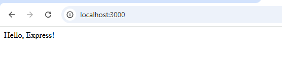

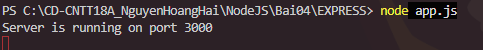

3.2. Route

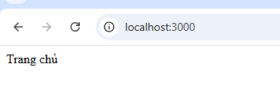

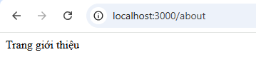

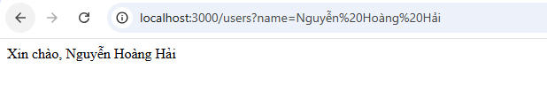

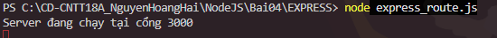

3.3. Middleware

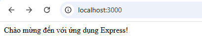

3.4. Template Engine Pug

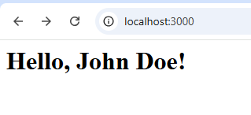

3.5. Template Engine Handlebars

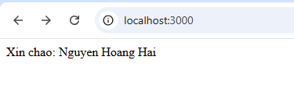

3.6. Error Handling

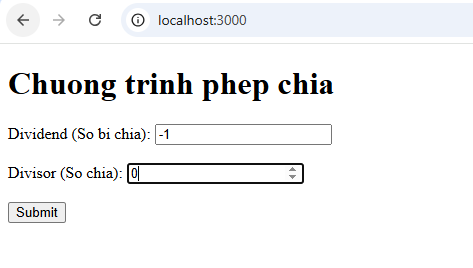

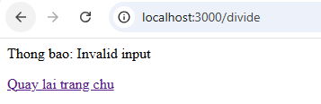

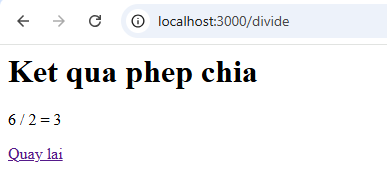

3.7. Dự án Express kết hợp MVC

Phép cộng

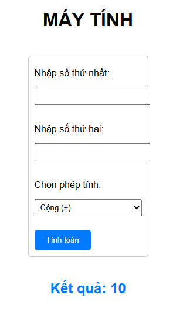

Phép trừ

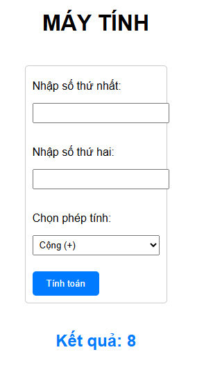

Phép nhân

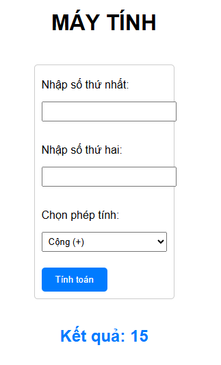

Phép chia

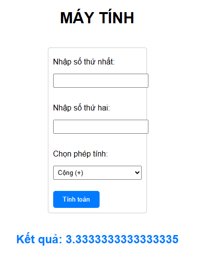

Kiểm tra xử lý lỗi

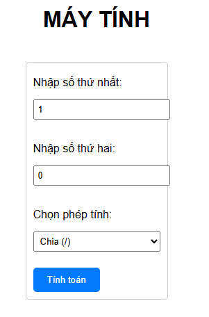

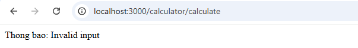

4. Kết quả
Đã thực hiện các ví dụ Express Framework và xây dựng ứng dụng máy tính sử dụng mô hình MVC trên máy tính cá nhân.